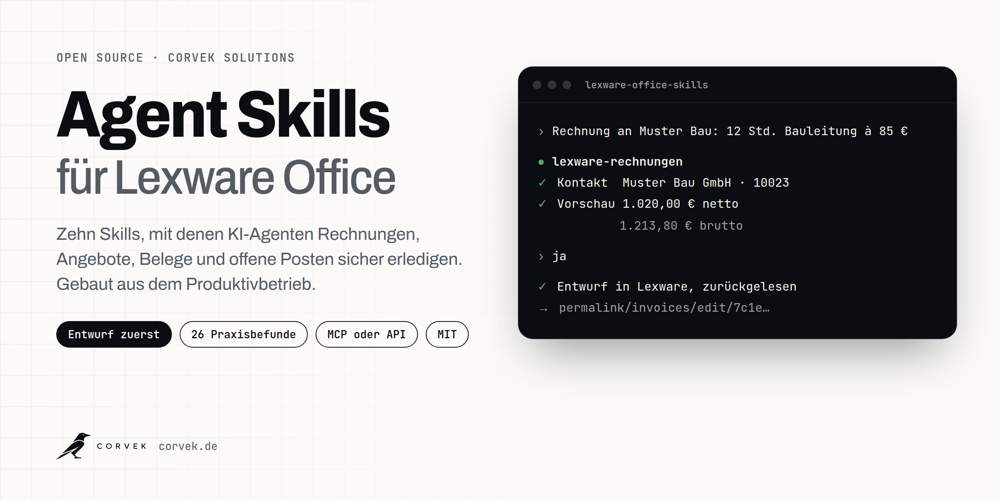
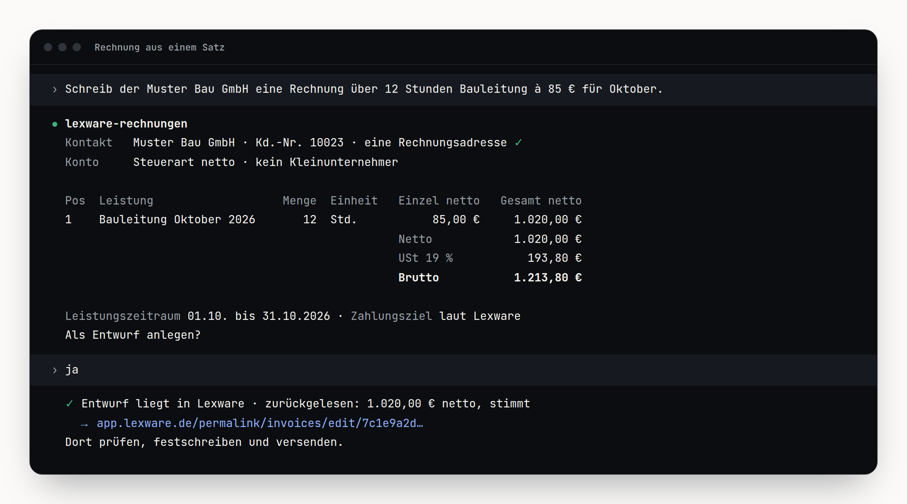
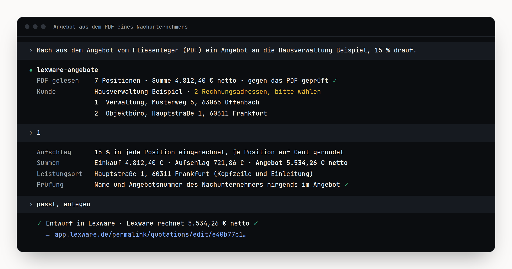
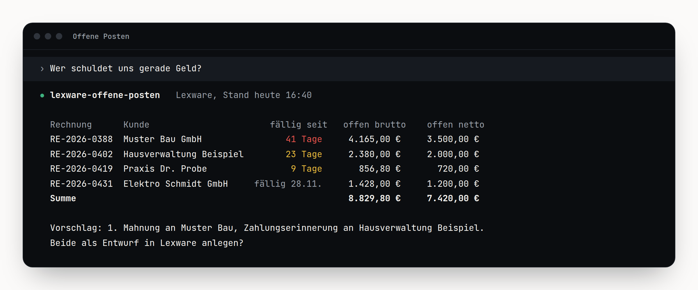
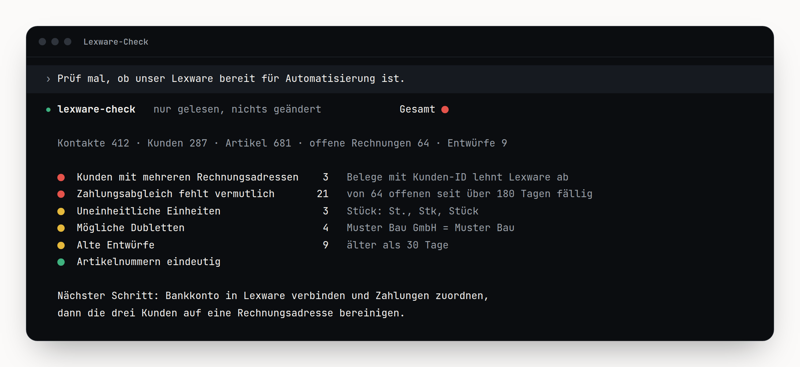

<p align="center">
  
</p>

<p align="center">
  <b>Zehn Skills, mit denen KI-Agenten in Lexware Office arbeiten wie ein erfahrener Profi:<br>
  Entwurf zuerst, Summen nachgerechnet, Fehler verstanden, Direktlink dabei.</b>
</p>

<p align="center">
  
  
  
  
  
</p>

---

## Worum es geht

**Agent Skills** sind Anleitungen mit Werkzeugen, die ein KI-Agent genau dann lädt, wenn er sie braucht. Dieses Paket
bringt ihm Lexware Office bei. Nicht nur, welche Endpunkte es gibt, sondern wie man damit im echten Betrieb arbeitet:
was zuerst geprüft wird, was nie ohne Rückfrage passiert, warum Lexware eine Rechnung ablehnt und wie man es behebt.

Entstanden ist es aus Lexware-Automatisierungen, die wir für Betriebe in Bau, Sanierung und Gebäudebetrieb gebaut haben
und täglich betreiben: Angebote aus dem Postfach, Rechnungsfreigabe mit Eingangsbelegen, Kennzahlen-Cockpits,
Lesezugriff für KI-Agenten im Team. Dazu kommen die besten Ideen aus den öffentlichen Lexware-Projekten auf GitHub,
geprüft und neu geschrieben ([Quellen](CREDITS.md)).

## So sieht das aus

<p align="center"></p>

<table>
  <tr>
    <td width="50%"></td>
    <td width="50%"></td>
  </tr>
  <tr>
    <td><b>Angebot aus dem PDF eines Nachunternehmers.</b> Positionen gelesen und gegen die PDF-Summe geprüft, Aufschlag je Position, Name des Nachunternehmers nirgends im Angebot.</td>
    <td><b>Wer schuldet uns Geld?</b> Offene Rechnungen nach Tagen über Fälligkeit, netto anteilig richtig gerechnet, Mahnung als Entwurf auf Zuruf.</td>
  </tr>
</table>

<p align="center"></p>

<p align="center"><sub>Alle Daten in den Bildern sind erfunden.</sub></p>

## Die zehn Skills

| | Skill | Was er kann | Sag zum Beispiel |
| :---: | --- | --- | --- |
|  | [**lexware-grundlagen**](skills/lexware-grundlagen/SKILL.md) | Anschluss über den offiziellen Lexware-MCP-Server oder die Public API, Schlüssel sicher ablegen, Fehler lesen, die sechs Regeln. Pflicht für alle anderen | „Verbinde Lexware“ · „Warum kommt 406?“ |
|  | [**lexware-rechnungen**](skills/lexware-rechnungen/SKILL.md) | Rechnung aus einem Satz, Gutschrift, Rechnung aus Angebot, Kleinunternehmer, § 13b, XRechnung, PDF | „Schreib Muster Bau 12 Stunden Bauleitung à 85 € in Rechnung“ |
|  | [**lexware-angebote**](skills/lexware-angebote/SKILL.md) | Angebot aus Satz, Artikelstamm oder Nachunternehmer-PDF mit Aufschlag oder Handling Fee, weiterführen zu Auftragsbestätigung und Rechnung | „Mach aus dem PDF ein Angebot, 15 % drauf“ |
|  | [**lexware-kontakte**](skills/lexware-kontakte/SKILL.md) | Kunden und Lieferanten finden und anlegen ohne Dubletten, Rechnungsadressen prüfen, sauber ändern | „Gibt es Müller & Söhne schon?“ |
|  | [**lexware-artikel**](skills/lexware-artikel/SKILL.md) | Artikelstamm pflegen, Leistungsverzeichnisse und Preislisten importieren, mit Protokoll und Rückbau | „Importier das Leistungsverzeichnis“ |
|  | [**lexware-belege**](skills/lexware-belege/SKILL.md) | Eingangsrechnungen und Quittungen zur Belegerkennung hochladen oder fertig buchen, Kategorie nach Namen, Dublettenprüfung | „Ab damit in Lexware“ |
|  | [**lexware-offene-posten**](skills/lexware-offene-posten/SKILL.md) | Offene und überfällige Rechnungen, Zahlstand, Mahnstufen, Mahnung als Entwurf, Liquiditätsvorschau | „Wer schuldet uns Geld?“ |
|  | [**lexware-auswertungen**](skills/lexware-auswertungen/SKILL.md) | Umsatz je Monat und Kunde, Vorjahresvergleich, Angebotsquote, CSV-Export, mit Zwischenspeicher | „Wie lief der Oktober?“ |
|  | [**lexware-check**](skills/lexware-check/SKILL.md) | Gesundheitscheck des Kontos als Ampel-Bericht: Adressen, Dubletten, Artikel, Entwürfe, Zahlungsabgleich | „Ist unser Lexware bereit für Automatisierung?“ |
|  | [**lexware-automatisierung**](skills/lexware-automatisierung/SKILL.md) | Webhooks mit Signaturprüfung, Abfrage als Rückfall, nichts doppelt anlegen, Testbetrieb, n8n | „Sag Bescheid, wenn eine Rechnung bezahlt ist“ |

## In zwei Minuten startklar

**1. Installieren**

In Claude Code als Plugin:

```
/plugin marketplace add corvek-solutions/lexware-office-skills
/plugin install lexware-office@corvek
```

Oder als Ordner, für jedes Werkzeug, das Agent Skills liest:

```
git clone https://github.com/corvek-solutions/lexware-office-skills.git
cp -R lexware-office-skills/skills/* ~/.claude/skills/
```

Desktop-Apps, Web und weitere Werkzeuge: [docs/installation.md](docs/installation.md).

**2. Lexware verbinden**, ein Weg genügt:

- **Offizieller Lexware-MCP-Server** für Chat-Assistenten: als Konnektor `https://mcp.lexware.de/mcp` hinzufügen und mit
  dem eigenen Lexware-Login anmelden ([Anleitung von Lexware](https://developers.lexware.io/mcp/docs/)).
- **Public API** für Agenten im Terminal und Automatisierungen: In Lexware unter Erweiterungen › Public API einen
  Schlüssel erzeugen, selbst ablegen (nie in den Chat), dann prüfen:

  ```
  security add-generic-password -s lexware-api-key -a "$USER" -w     # macOS, fragt verdeckt
  python3 skills/lexware-grundlagen/scripts/lexware.py pruefen
  ```

Beides braucht Lexware Office mit Schnittstelle (Tarif XL).

**3. Loslegen.** Am besten mit: *„Prüf unser Lexware.“*

## Sicherheit ist eingebaut, nicht angehängt

- **Entwurf zuerst.** Belege entstehen als Entwurf. Festschreiben nur, wenn der Mensch es ausdrücklich sagt; das
  Werkzeug sperrt `finalize=true` ohne den Schalter `--festschreiben`.
- **Erst zeigen, dann schreiben.** Vor jedem Anlegen eine Vorschau mit nachgerechneten Summen, danach zurücklesen und
  vergleichen.
- **Kein Schlüssel im Chat.** Schlüsselbund, Datei mit Rechten 600 oder Umgebungsvariable; nie in einer Ausgabe.
- **Nichts doppelt.** Abgebrochenes Schreiben wird nie blind wiederholt, sondern erst nachgesehen.
- **Nur-Lesen-Modus** mit `LEXWARE_NUR_LESEN=1`, für Auswertungen und den Check automatisch.
- **Keine Abhängigkeiten, keine Telemetrie, keine Hooks, keine mitgelieferten Einstellungen.** Feste Adresse
  `api.lexware.io`. Details in [SECURITY.md](SECURITY.md).

## Aus der Praxis

Fünf von [39 Befunden](skills/lexware-grundlagen/referenz/fallstricke.md), 26 davon im Betrieb selbst geprüft:

1. **429 und 406 sind verschiedene Welten.** 429 heißt warten. 406 heißt „deine Angaben sind falsch“ und wird nie
   wiederholt; das Feld steht in `details[]`.
2. **Ein Beleg an einen Kunden mit zwei Rechnungsadressen scheitert**, außer die Adresse steht ausgeschrieben im Beleg.
3. **`voucherDate` ist ein Kalendertag in deutscher Zeit.** Ein fest eingetragenes `+02:00` datiert im Winter jedes
   Angebot auf den Vortag.
4. **„Offen“ ist nur so gut wie der Zahlungsabgleich.** Ohne verbundenes Bankkonto stehen bezahlte Rechnungen weiter
   als offen da.
5. **Eine Artikel-Referenz übernimmt über die API nichts**, anders als in der Oberfläche. Alle Felder mitschicken.

## Offizieller MCP-Server und Skills: zwei Hälften

Seit November 2026 bietet Lexware einen eigenen MCP-Server mit 40 Werkzeugen. Der Server liefert die **Hände**: Kontakte
lesen, Rechnungen anlegen, Dokumente laden. Diese Skills liefern das **Urteil**: welche Schritte in welcher
Reihenfolge, was vorher geprüft wird, was nie ohne Rückfrage passiert, wie ein Fehler in einen verständlichen Satz
wird. Jeder Skill nennt für seine Schritte das passende MCP-Werkzeug und die Entsprechung in `lexware.py`. Dazu kommt,
was der MCP-Server nicht abdeckt: Belegdateien hochladen, Massenimporte, CSV-Auswertungen, Webhooks.

## Für Betriebe und Teams

Die Skills sind frei verfügbar und funktionieren für sich. Wenn Lexware in einen größeren Ablauf gehört, bauen wir
die individuelle Lösung dazu: Angebotsstrecken aus dem Postfach, Rechnungsfreigabe mit Eingangsbelegen, eine
[Brücke für ganze Teams](docs/team-bruecke.md) mit Rechten je Person, Cockpits mit Kennzahlen aus Lexware und die
Bereinigung der Stammdaten vorher.

**Corvek Solutions** · individuelle Softwarelösungen und Automatisierungen mit KI ·
[corvek.de](https://corvek.de) · [Termin vereinbaren](https://corvek.de/termin-2)

## Mitmachen

Fehler gefunden, Befund aus dem eigenen Betrieb, neue Idee? Issues und Pull Requests sind willkommen. Neue Befunde
bitte mit Herkunft (selbst geprüft oder Doku-Link). Tests ohne Lexware-Konto:

```
python3 -m unittest discover -s tests -v
node --test tests/*.mjs
```

Prüfszenarien für Agenten: [evals/szenarien.md](evals/szenarien.md).

## Lizenz und Marken

MIT, siehe [LICENSE](LICENSE). Icons auf Grundlage von [Lucide](https://lucide.dev) (ISC, [Lizenz](assets/icons/LICENSE-lucide.txt)).

Lexware und Lexware Office sind Marken der Haufe-Lexware GmbH & Co. KG bzw. der Haufe Group. Dieses Projekt ist
unabhängig und wird von Lexware weder betrieben noch unterstützt oder geprüft.
